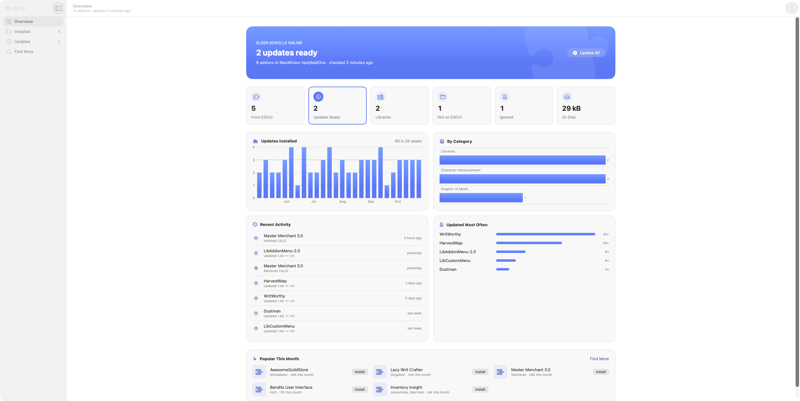
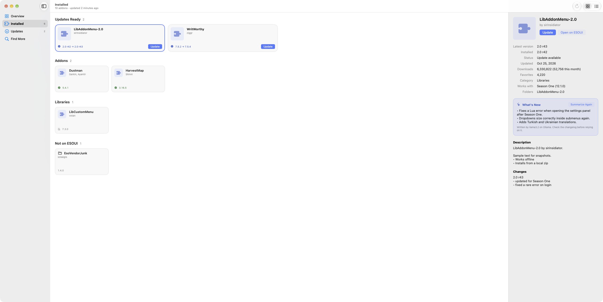

# MacMinion — ESO addon manager for macOS

[](https://github.com/solaegis/mac-minion/releases/latest)

[](LICENSE)

A native macOS addon manager for The Elder Scrolls Online (ESO), and a Mac alternative to Minion.
Find, install, update, back up, and remove [ESOUI](https://www.esoui.com) addons without the Java Minion app.

**[Download](https://github.com/solaegis/mac-minion/releases/latest)** · **[Documentation](https://solaegis.github.io/mac-minion/)** · [Changelog](CHANGELOG.md)



MacMinion runs on this Mac only. There is no account and no server of its own. It reads your AddOns folder, matches folders to the public ESOUI catalog, and downloads zips when you install or update.

## Features

- **Overview** of how your addons stand, with recent activity and popular catalog picks; show, hide, and reorder its sections
- **Installed** list or card grid, matched to ESOUI (unmatched local folders stay visible)
- **Updates** for one addon or all of them (⌘U), two downloads at a time by default
- **Find More** to search and browse the catalog, read details and changelogs, then install
- Filters on Installed and Find More: category, status, update age, rating, current game version, and libraries
- Ignore updates for addons you want to pin; Update All skips them
- Remove an addon to the Trash; SavedVariables are left alone
- Install any older release ESOUI still has (Version menu in an addon's details); older versions are pinned
- Backups of SavedVariables, settings files, and the addon list, in Minion's own format and folder, so either app restores the other's (Backups in the sidebar, ⌘B)
- Live or PTS AddOns folder (or any folder you choose)
- Menu bar extra with the update count and Update All
- Checks ESOUI for updates once a day by default (Settings → Updates)
- Optional AI, via Ollama on this Mac, Claude, or OpenAI:
  - changelog summaries for one addon or every pending update
  - **Recommended for You** on the Overview: addons that would add something to the ones you have
  - a search bar on the Overview that finds addons from a description in your own words
  - thumbs up and down on any addon steer both; a thumbs down keeps that addon out of them
  - for Ollama, a model recommendation for this Mac from the models on your server, using its memory, what is loaded, and a speed benchmark

ESO only. No WoW catalog, no login, and no cloud backup or SavedVariables sync.



## Requirements

- macOS 26 or later, Apple Silicon
- The Elder Scrolls Online AddOns folder (default `~/Documents/Elder Scrolls Online/live/AddOns`)
- Xcode 26 or later (Swift 6.2) only if you build from source

## Install

### Download (Apple Silicon)

1. Open the [latest GitHub Release](https://github.com/solaegis/mac-minion/releases/latest).
2. Download `MacMinion-*-macos-arm64.zip`.
3. Unzip and drag `MacMinion.app` into `/Applications` or `~/Applications`.
4. Open it the first time with a right-click → **Open**.

The release is signed with MacMinion's own certificate, not an Apple Developer ID, and isn't notarized, so Gatekeeper asks once for a download from the internet. That first-open step is expected. If macOS still blocks it, use System Settings → Privacy & Security → **Open Anyway**, or:

```bash
xattr -cr ~/Applications/MacMinion.app
open ~/Applications/MacMinion.app
```

To put the CLI on your PATH after a download:

```bash
mkdir -p ~/.local/bin
ln -sf ~/Applications/MacMinion.app/Contents/MacOS/MacMinion ~/.local/bin/macminion
```

### Build from source

```bash
git clone https://github.com/solaegis/mac-minion.git
cd mac-minion
./build.sh --open
```

That installs `~/Applications/MacMinion.app` and a `macminion` link in `~/.local/bin`. To stop macOS asking for Documents access after every build, create a local signing identity once with `tools/make-signing-identity.sh`; `build.sh` uses it from then on. The build signs with your Apple Development certificate when Xcode has one, otherwise ad hoc. An app you build on this Mac is not quarantined, so it usually opens without the Gatekeeper step.

## Use

- **Overview**, **Installed**, **Updates**, and **Find More** in the sidebar
- **Update All** with ⌘U; **Check for Updates** with ⌘R
- Switch Installed and Find More between grid and list from the toolbar, or Option-⌘-1 / Option-⌘-2
- Menu bar item: update count, Update All, Open MacMinion
- Settings (⌘,): General, Updates, Layout, AI, Appearance

## Coming from Minion

On first launch MacMinion reads `~/.minion/minion.xml` once (installed versions, ignored addons, and Minion’s update log). Minion’s own files are not changed. Settings → General → **Import from Minion** runs that import again.

Turn off Minion’s auto-update so the two apps do not both write to AddOns.

## Privacy

State lives in `~/Library/Application Support/MacMinion/` (install records and a cached catalog). MacMinion has no account. It goes online only for public ESOUI feeds (`https://api.mmoui.com`) and addon zip downloads. AI stays off until you pick a provider in Settings → AI. With Ollama, prompts stay on your Mac (or go to the Ollama server you set). With Claude or OpenAI, addon names, descriptions, and changelog text are sent to that provider only: to `api.anthropic.com` or `api.openai.com`, never anywhere else. There is no telemetry. API keys are kept in your login Keychain, never in preferences, logs, or error messages.

## AI providers

Pick one in Settings → AI. Each keeps its own model and key, so switching back and forth loses nothing.

| Provider | Setup | Model |
| --- | --- | --- |
| Ollama (on this Mac) | Install [Ollama](https://ollama.com) and pull a chat model. No key. The server defaults to `http://localhost:11434`; change it in Settings. | Chosen from the models on your server; MacMinion recommends one for this Mac. |
| Claude | Create a key at [console.anthropic.com](https://console.anthropic.com), paste it, and press **Save to Keychain**. | `claude-opus-5-5` by default |
| OpenAI | Create a key at [platform.openai.com](https://platform.openai.com), paste it, and press **Save to Keychain**. | `gpt-6-astra` by default |

- **Test Connection** sends one tiny request. The status reads No key configured, Not tested, Connected, Invalid key, or Rate limited.
- **Remove Key** deletes the key from the Keychain.
- Keys are Keychain items for service `com.solaegis.macminion`, accounts `claude-api-key` and `openai-api-key`, readable only while your Mac is unlocked. Keychain Access shows them as "MacMinion Claude API key" and "MacMinion OpenAI API key".
- Model IDs change often. The defaults were current on 2026-10-28 and may need updating. Type any ID in the Model field, or press the list button (refresh fetches what your key can use; the last list is kept for offline use).
- Claude uses the Messages API (`anthropic-version: 2026-10-21`); OpenAI uses Chat Completions (`/v1/chat/completions`), not the Responses API.
- MacMinion is not sandboxed, so no network entitlement is needed. If it is ever sandboxed, it needs `com.apple.security.network.client` for all three providers, Ollama on localhost included.
- Known limitations: no tool or function calling (MacMinion only asks for text), and one prompt per request rather than a chat history.

## Command line

`./build.sh` also links `macminion` on your PATH. Run `macminion help` for commands such as `status`, `addons list`, `catalog search`, `updates install`, `addons recommend`, and `ai benchmark`. Add `--json` for agents. The app must be running (or the command will launch it). `.claude/skills/macminion/SKILL.md` teaches Claude Code the commands.

## Help

The [documentation](https://solaegis.github.io/mac-minion/) covers install, first open, backups, AI setup, and [troubleshooting](https://solaegis.github.io/mac-minion/troubleshooting.html). For anything else, [open an issue](https://github.com/solaegis/mac-minion/issues/new/choose). Report security problems privately, as [SECURITY.md](SECURITY.md) explains.

## Contributing

Bug reports and ideas are welcome. Read [CONTRIBUTING.md](CONTRIBUTING.md) for how to build, test, and send a change.

## Credits

MacMinion is an unofficial, independent Mac replacement for [Minion](https://minion.mmoui.com), the addon manager made by [MMOUI](https://www.mmoui.com) for [ESOUI](https://www.esoui.com). It stands on their work:

- The addon catalog, details, and downloads come from MMOUI's public ESOUI feeds (`api.mmoui.com`).
- Backups use Minion's own folder and format, and the first launch imports Minion's settings, so the two apps work side by side.
- The screens, the "Minion" name, the red one-eyed icon, and Minion Red are modeled on Minion.
- Every addon is the work of its author on ESOUI. Please rate, thank, and support them there.

MacMinion is not made by, affiliated with, or endorsed by MMOUI, ESOUI, ZeniMax Online Studios, or Bethesda. The Elder Scrolls Online is a trademark of ZeniMax Media Inc. The same credits are in MacMinion > About MacMinion.

## License

Copyright Lewis Vavasour. MacMinion is licensed under the [PolyForm Noncommercial License 1.0.0](LICENSE). You may use it for personal, noncommercial purposes. Commercial use needs permission. The copyright stays with the author, who may offer other licenses later.
